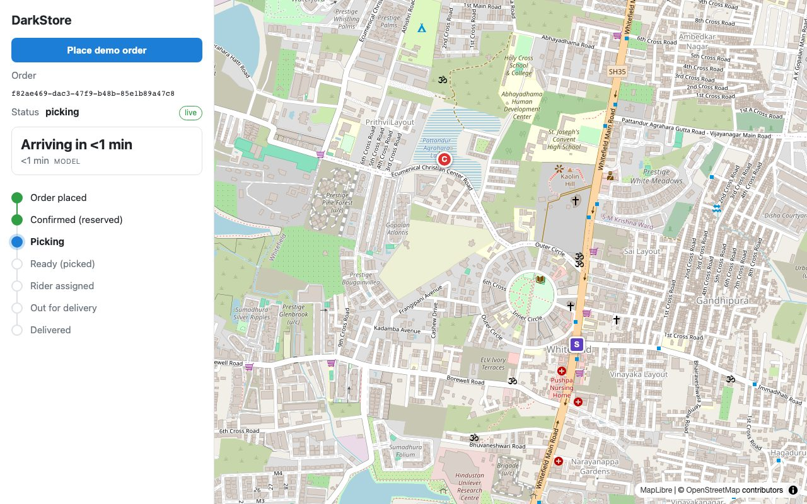
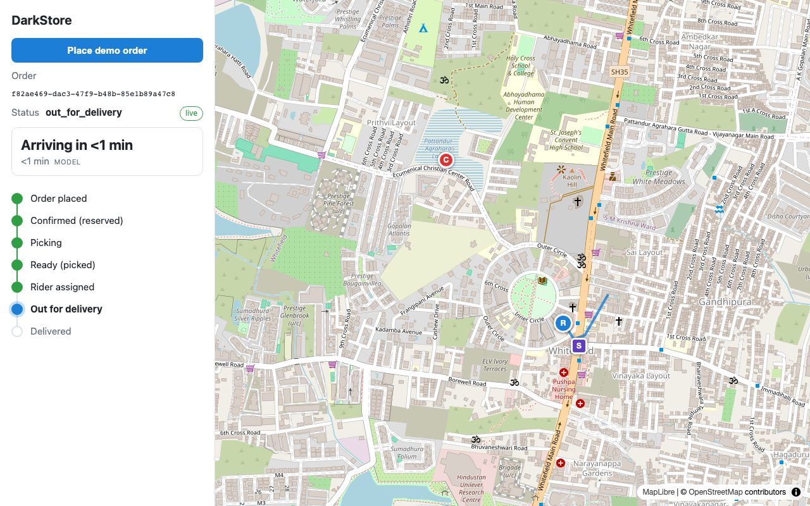
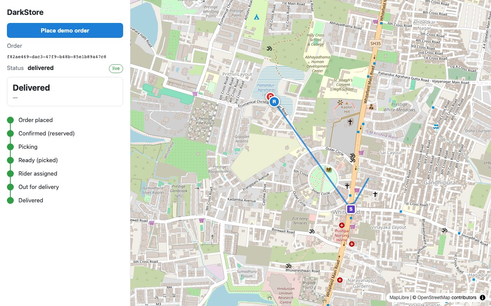
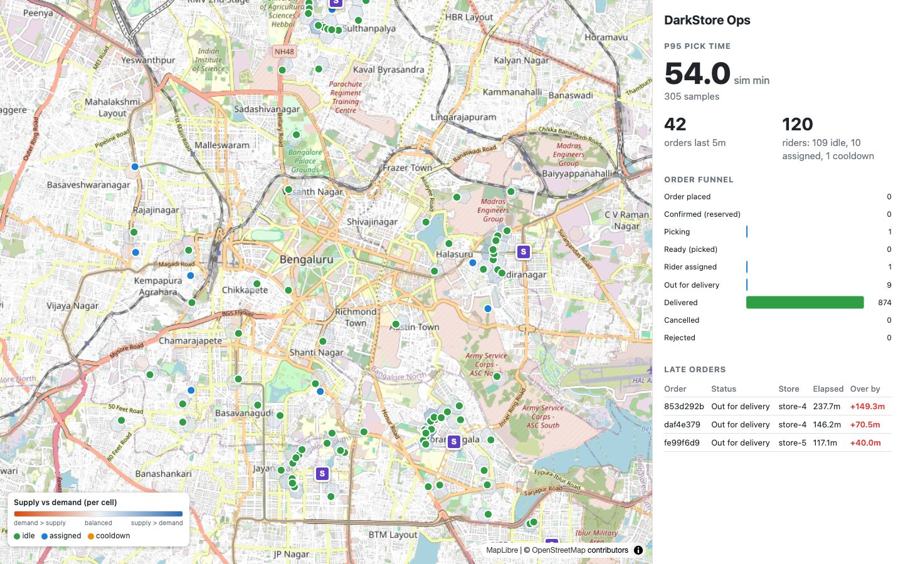
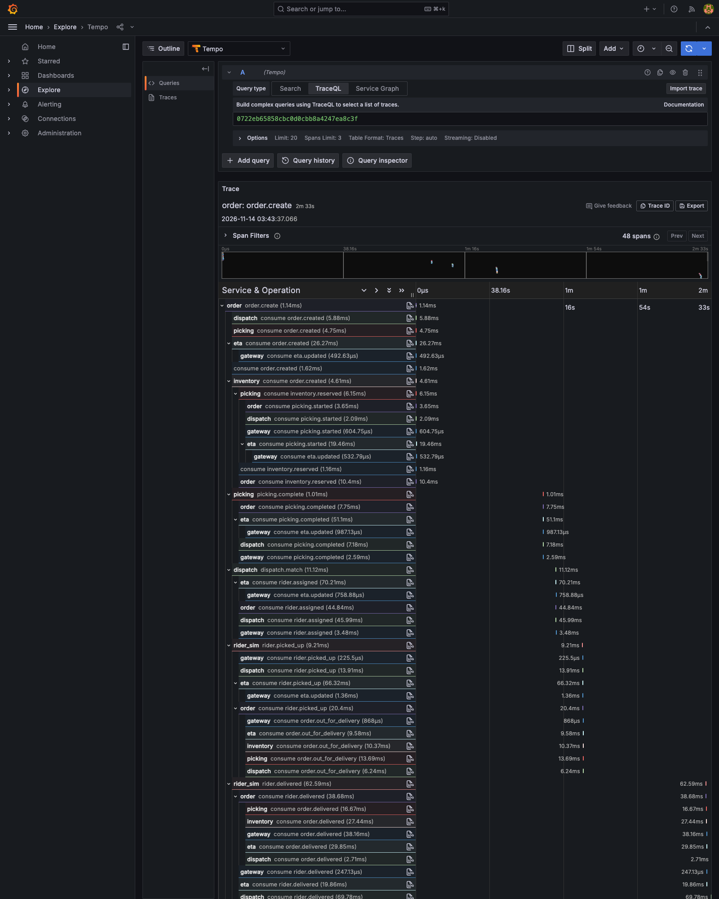
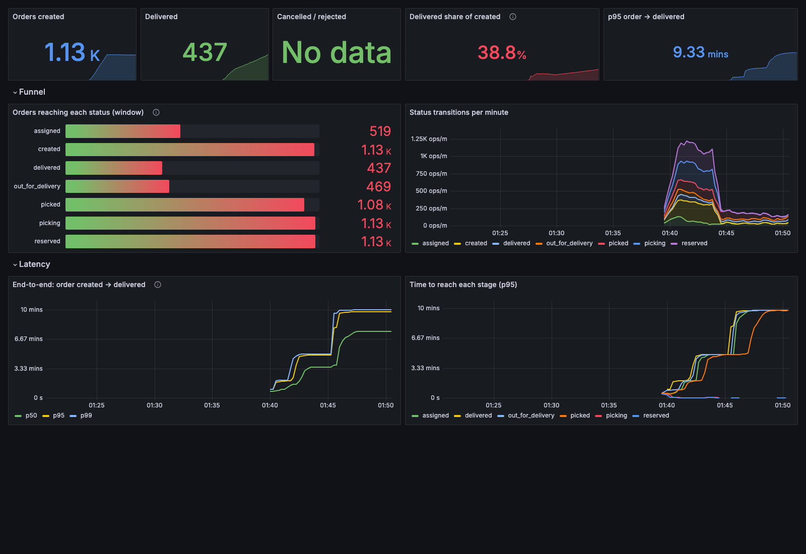
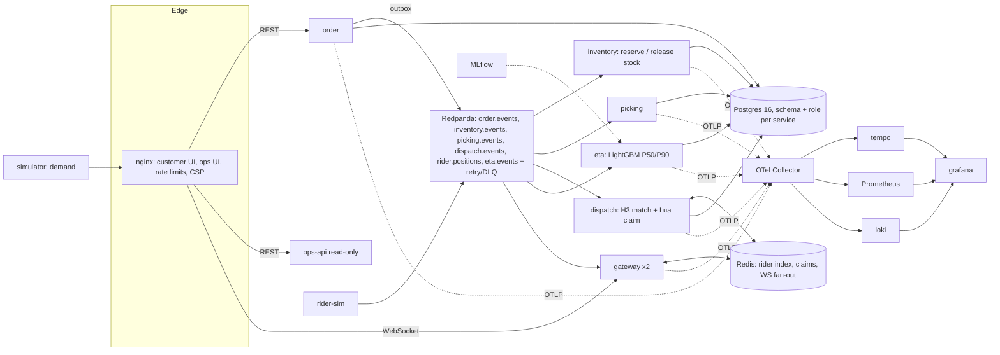

# DarkStore

A real-time quick-commerce order and ETA platform (Instamart / Zepto style) that runs end to end on a laptop with Docker Compose: place an order, watch it get reserved, picked, matched to a rider and delivered, with a live map, a calibrated ETA and one distributed trace per order.

```bash
make up      # build + start ~20 containers, wait until healthy, print URLs
make demo    # train the ETA model if needed, start the order simulator, print live stats + URLs
make down    # stop                make clean      # stop and wipe all volumes (a full reset)
```

**Running it needs only Docker (Compose v2, with about 4 GB given to the Docker VM) and `make`.** Everything is built and run in containers: the Python services share one image, the React apps are built in the `web` image (multi-stage, Node only inside the build), and the ETA model is trained by a one-shot `trainer` container (`make train`, `make retrain`). I checked this by running `make demo` from scratch (volumes wiped, built web assets and trained model moved aside) with `uv`, `node` and `npm` removed from `PATH`: it finished with exit 0 and orders were delivered.

Host tooling is only for development and verification: `uv` for `make test` / `test-int` / `chaos` / `load`, Node for `make e2e` and front-end work (`make web`).

```bash
make test    # unit tests          make test-int   # integration tests (testcontainers)
make e2e     # Playwright          make chaos SCENARIO=kill-picking   make load
```

The demo simulator runs on a 30x clock with 1 order per simulated minute at base demand (`SIM_ORDERS_PER_MINUTE`, so 0.5/s before the rush multipliers), starting at 16:00 (`SIM_START_HOUR`). The simulated clock starts when the stack first boots (its epoch is kept in Redis), so run `make demo` right after `make up`; starting it much later begins later in the simulated day. Two runs measured on this machine:

- **Lunch peak** (sim hour ~13, about 1.1 orders/s target): 551 orders delivered in 15 minutes, order-to-delivered p50 103 s and p95 200 s, rider backlog 0-1. City-wide destinations make trips longer than in the load test, which is why these are slower than the load-ramp table.
- **Evening rush** (19:00-22:00 simulated, 3.0x, about 1.5 orders/s target; it starts 6 minutes after the simulator and lasts about 6): this is over what the 120-rider fleet can deliver. About 0.7 orders/s were delivered through the rush (262 in 6.1 minutes), so the orders waiting for a rider grew to about 250 and drained to 0 about 6 minutes after demand fell. The order pipeline itself stayed healthy: consumer lag was at most 4 in samples taken every 30 s, and the simulator logged 0 failed placements. That queue is what the `FleetStarved` alert and the ops late-orders table exist to show; lower `SIM_ORDERS_PER_MINUTE` to stay under capacity.

The earlier defaults (3 per simulated minute, starting at 18:00) asked for 1.5 orders/s at base and 4.5/s in the evening peak, so orders queued for many minutes (656 waiting after 33 minutes).

Everything below that is a number was measured on one MacBook (Docker VM ~4 GB / 8 CPUs, 120 simulated riders, six dark stores). Nothing is extrapolated. Raw files are linked next to each table.

## See it running

Screenshots from the running demo on this laptop (`make up && make demo`). They are real captures, not mock-ups: `web/e2e/readme-shots.mjs` places an order in the customer UI and records it, and the same script grabs the ops dashboard.

**One order, followed live in the customer UI.** The page opens a WebSocket to the gateway and the order moves through the saga in real time: the rider (R) appears once dispatch has claimed one, and the ETA card shows the model's estimate.

| Picking | Out for delivery | Delivered |
|---|---|---|
|  |  |  |

**Ops dashboard** (token URL from `make urls`): every rider on the map (green idle, blue assigned, orange cooldown) over the supply-vs-demand H3 cells, the dark stores (S), the order funnel, P95 pick time and the late-orders table. This capture was taken after the evening rush had drained, so most of the fleet is idle.



**One order is one trace**: the trace id is derived from the order id, so every service's spans for an order land in one Tempo trace (48 spans across 7 services in the capture below). Grafana ships five dashboards as code; the order funnel is shown here and the rest are in [docs/verification.md](docs/verification.md#screenshots-docsscreenshots-captured-from-the-running-stack).

| Distributed trace of one order | Grafana: order funnel |
|---|---|
|  |  |

## Architecture



The saga is choreographed over Kafka topics: `order.created` -> inventory reserves (or cancels) -> picking -> `order.ready` -> dispatch finds the nearest idle rider (H3 ring search, atomic Redis Lua claim) -> rider-sim picks up and delivers -> order service marks `delivered`. Every service writes its state change and its outgoing event in one DB transaction (outbox), consumes idempotently (`processed_events`), retries on 5 s / 30 s / 5 min topics and parks poison messages in a DLQ. Partition key is `order_id`, so one order's events are ordered. Design records are in [docs/adr](docs/adr/README.md).

URLs after `make up`: Customer UI http://localhost:8088, Ops UI (token URL printed by `make urls`), Grafana http://localhost:3000, Prometheus :9090, MLflow :5001, Redpanda Console :8080.

## Verification

Evidence is collected in [docs/verification.md](docs/verification.md) (test output, screenshots). Short version:

| Check | Result |
|---|---|
| Unit tests (`make test`) | 140 passed |
| Integration tests (`make test-int`, real Redpanda/Postgres/Redis) | 84 passed (stack stopped while they run). Details in docs/verification.md |
| Alert rules (`make test-alerts`, promtool) | 14 rules, SUCCESS |
| Playwright e2e: order to delivered in the browser | 6 passed (41 s) on the final stack |
| Chaos: six fault scenarios | **6 of 6 pass** (table below) |

## Numbers I measured

### Chaos (docs/chaos/*.json, `make chaos SCENARIO=...`)

40 orders at 0.25 orders/s, fault injected at +40 s, 300 s to settle. After each run the harness checks: no lost or duplicated order, one `order.created` and one `order.delivered` per delivered order, nothing stuck, stock + reserved conserved, DLQ unchanged, every WebSocket tracker reaches `delivered`.

| Scenario | Fault | Delivered | Create p95 (ms) | Failed attempts (retried) | DLQ | Stock conserved | Verdict |
|---|---|---|---|---|---|---|---|
| kill-picking | picking container killed 20 s | 40/40 | 616 | 0 | 0 | yes | PASS |
| kill-dispatch | dispatch killed | 40/40 | 195 | 0 | 0 | yes | PASS |
| kill-order | order service killed 18 s | 40/40 | 237 | 60 | 0 | yes | PASS |
| kill-gateway | one gateway replica killed | 40/40 | 173 | 0 | 0 | yes | PASS |
| broker-restart | Redpanda restarted | 40/40 | 185 | 0 | 0 | yes | PASS |
| broker-crash | Redpanda `kill -9` | 40/40 | 115 | 0 | 0 | yes | PASS |

The runs did not pass on the first try, and each failure was a real bug: a head-of-line-blocking bug in the dispatch matcher, riders drifting away from remote stores, and Redpanda's dev mode acknowledging writes before fsync (a `kill -9` lost acknowledged events). All three are fixed and explained in [ADR-0008](docs/adr/0008-chaos-findings.md).

### Load ramp (docs/load/results.md, `make load`, ~9 min, through nginx)

| Target | Created/s | Delivered/s | Create p50 / p95 / p99 (ms) | Order to delivered p50 / p95 (s, server) | DLQ |
|---|---|---|---|---|---|
| 0.5/s | 1.01 | 0.90 | 36 / 153 / 180 | 23 / 53 | 0 |
| 1/s | 1.42 | 1.42 | 25 / 139 / 332 | 25 / 55 | 0 |
| 1.5/s | 1.87 | 1.80 | 36 / 226 / 471 | 24 / 55 | 0 |
| 2/s | 2.28 | 1.95 | 35 / 276 / 480 | 31 / 57 | 0 |
| 3/s | 3.19 | 2.80 | 62 / 336 / 754 | 35 / 58 | 0 |
| 4/s | 4.08 | 3.27 | 78 / 365 / 515 | 44 / 91 | 0 |

How to read it honestly:
- **The platform kept up to about 3 orders/s.** Up to the 3/s stage delivered/s stays within ~12% of created/s and order-to-delivered p95 stays near 58 s. At the top stage (4.08 created/s) delivery falls behind (3.27/s), consumer lag peaks at 168 and order-to-delivered p95 rises to 91 s: the backlog is starting to build. At that stage the order service and gateway sat at 60-83% of one core each, so the first limit on this machine is CPU in the ingress path, with the 120-rider fleet close behind. I did not push past the top stage, so I cannot say where it breaks.
- Zero orders were lost or sent to the DLQ at any stage; the 12 WebSocket trackers had 0 failures and 0 reconnects.
- **This replaces an earlier run of the same ramp** that topped out near 2 created/s with create p95 in the seconds. That run came before the final dispatch fix (per-store batching), the stack had been up for many hours with leftover state, and its client placed some orders outside the delivery area. I did not isolate which of those caused the difference, so treat this table as the current measurement and the old one as superseded, not as a before/after comparison.
- The whole stack, the load generator and the browser share one laptop and a 4 GB Docker VM; these are single-machine numbers, not capacity claims.
- WebSocket trackers (12 live sockets) numbers are in docs/load/results.md.

### ETA model (docs/ml/eta-report.md, simulated trips, held-out last 15%)

| | Heuristic | Calibrated heuristic | LightGBM |
|---|---|---|---|
| MAE (min) | 12.00 | 4.69 | **3.98** |
| P90 coverage (target 90%) | 41.1% | 90.1% | 89.9% |

LightGBM beats the calibrated heuristic by 14-17% MAE (95% CI by trip bootstrap). This is on simulated data, so it shows the pipeline and the method work, not that the model would match production.

## Security (P7)

Audit, fixes and the full threat discussion are in [ADR-0007](docs/adr/0007-guest-sessions-authz-and-db-roles.md): anonymous guest sessions, per-order tracking tokens, authorization before lookup (no existence oracle), idempotency keys scoped per customer, per-service Postgres roles (the ops API is read-only), outbox and `processed_events` retention, nginx rate limits and body caps, a CSP, API docs hidden by default.

## Trade-offs I made

- **Postgres outbox over Kafka transactions.** Simple, debuggable, exactly the failure mode chaos tests; cost is a relay loop and an extra write.
- **Choreography over an orchestrator.** Few services, clear events; the price is that the saga lives in several places (ADR-0003 and the tracing UI are how you see it whole).
- **H3 res 8 ring search + Redis Lua claim for matching.** Fast and race-free; it is nearest-idle-rider, not a global assignment optimiser.
- **One shared Docker image for all Python services.** One build, one dependency set; every service ships every service's code.
- **Simulation for demand, riders and trips.** Lets everything run on a laptop; all ETA and load numbers are on simulated data.

## Known deviations from a production system

- Tables are created with `create_all`, not Alembic migrations.
- Guest sessions instead of real customer accounts. Tokens are HMAC-signed with one shared secret (no `kid`, no rotation, any service that can verify can mint).
- No per-customer cap on active orders: unassigned orders hold stock reservations until they time out. Mitigated only by the session and order rate limits at nginx.
- Dev ports (Postgres, Redis, Prometheus, Grafana, MLflow, Console) are unauthenticated or lightly protected and bound to loopback only. No Kafka SASL/TLS, no Alertmanager, images pinned by tag not digest.
- The scorer has a batching term that is unused (riders carry one order).
- Playwright (`make e2e`) is installed through npm on the host. Everything else, including LightGBM training, runs in containers.
- The one-image-for-all-services Docker image is about 1.75 GB (LightGBM, pandas, pyarrow ship in every service). Per-service images would be smaller; not done.
- Outbox rows marked published cannot be reconciled against the broker (would need a reconciler; see ADR-0008).

## What I would change at Swiggy / Zepto scale

- Geo-shard dispatch by city/zone with its own rider index, rather than one Redis; move claims to a partitioned store with fencing.
- Replace the dev single-node broker with a replicated cluster (RF 3, `acks=all`, rack awareness), partition by zone as well as order, and size partitions for consumer parallelism.
- Real accounts, short-lived asymmetric tokens, mTLS between services, Kafka ACLs, per-service secrets in a manager.
- Alembic migrations, per-service databases, read replicas for the ops/tracking read path.
- Batched multi-order riders and a global assignment solver (the scorer already has the term), with live traffic instead of the simulated speed model.
- Trace sampling (one trace per order is fine here, not at millions of orders/day), Alertmanager and paging, SLO burn-rate alerts (the 14 rules here are the starting point).
- Admission control and load shedding in front of order creation, so a demand spike degrades gracefully instead of building an unbounded backlog.

## Where things are

- [docs/runbook.md](docs/runbook.md): start/stop/reset, alerts, tracing an order, tokens, chaos
- [docs/adr](docs/adr/README.md): decisions 0001-0008
- [docs/api/realtime.md](docs/api/realtime.md): REST + WebSocket protocol
- [docs/observability.md](docs/observability.md), [docs/ml](docs/ml), [docs/load](docs/load), [docs/chaos](docs/chaos), [docs/screenshots](docs/screenshots)
- `PLAN.md`: the phase plan

## License

[MIT](LICENSE)
