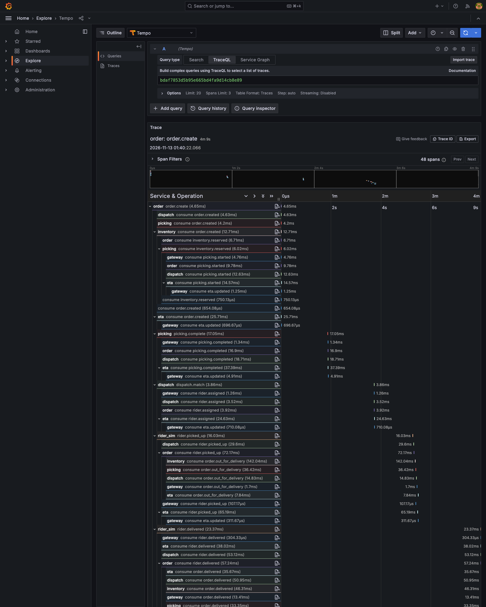

# Observability

Design and trade-offs: [ADR-0006](adr/0006-observability.md). Everything here runs in `make up`.

| What | Where | Notes |
|---|---|---|
| Grafana (dashboards, Explore) | http://localhost:3000 | user `admin`, password `GRAFANA_ADMIN_PASSWORD` in `.env` |
| Prometheus (queries, `/alerts`, `/rules`) | http://localhost:9090 | scrapes the OTel Collector every 10 s |
| Tempo (traces) | http://localhost:3200 | queried through Grafana |
| Loki (logs) | http://localhost:3100 | queried through Grafana; log lines carry `trace_id` |

## One trace per order

Open Grafana → Explore → Tempo → TraceQL and paste the order's trace id, or compute it:

```bash
python3 -c "import hashlib,sys; print(f'{int.from_bytes(hashlib.sha256(b\"trace:\"+sys.argv[1].encode()).digest()[:16],\"big\"):032x}')" <order_id>
```

(`darkstore_common.telemetry.order_trace_id`.) Or search: `{ name = "order.create" }`,
`{ span.order.id = "<order_id>" }`, `{ status = error }`.



A delivered order produced a single trace of 58-65 spans across `order`, `inventory`, `picking`,
`dispatch`, `rider_sim`, `eta` and `gateway`, nested as a causal tree (verified by fetching it from
Tempo and checking that every span's parent is in the trace, and by `tests/integration/test_trace.py`).
Reading it: `order.create` is the root; each `consume <event>` span is a consumer continuing the
producer's trace from the Kafka `traceparent` header; `picking.complete`, `dispatch.match`,
`rider.picked_up`, `rider.delivered` are timer-driven work attached to the order. The long gap in
the screenshot is real: that order waited ~11 minutes for a rider because the demo fleet was saturated.

Not traced on purpose: `rider.position` events (metrics only) and failed rider searches (counted in
`darkstore_assignments_total{outcome="no_rider"}`; a span per miss would flood Tempo).

## Dashboards (Grafana → DarkStore folder)

Generated by `scripts/gen_dashboards.py` (`make dashboards`; CI-style check: `--check`). Query
validity against a live Prometheus: `python3 scripts/check_dashboards.py`.

| # | Dashboard | Answers |
|---|---|---|
| 1 | [Order funnel & latency](screenshots/grafana-1-order-funnel.png) | How many orders reach each status; time to each stage and end to end |
| 2 | [Kafka lag & DLQ](screenshots/grafana-2-kafka.png) | Backlog per consumer group, retries, dead letters, duplicates, pipeline latency |
| 3 | [Matching & assignment](screenshots/grafana-3-matching.png) | Wait for a rider, search duration, outcomes |
| 4 | [ETA accuracy & drift](screenshots/grafana-4-eta.png) | MAE, P90 coverage, bias, fallback share, now vs 1 h ago |
| 5 | [WebSocket & fan-out](screenshots/grafana-5-websocket.png) | Connections per replica, hub→socket wait, slow-client drops |

Regenerate the screenshots with `cd web && node e2e/grafana-shots.mjs <order_id>`.

## Metric catalog

Defined once in `telemetry.Instruments`; Prometheus names after the Collector's exporter. Resource
labels `service_name` and `service_instance_id` are added to everything.

| Metric | Type | Labels | Meaning |
|---|---|---|---|
| `darkstore_events_total` | counter | group, event_type, outcome | `ok`, `duplicate`, `retry`, `dlq` |
| `darkstore_event_handle_seconds` | histogram | group, event_type | handler duration |
| `darkstore_event_age_seconds` | histogram | group, event_type | now − `occurred_at` when the consumer starts |
| `darkstore_consumer_lag` | gauge | group, topic | log end − position (retry topics included), sampled every 5 s |
| `darkstore_order_transitions_total` | counter | status | orders entering each status |
| `darkstore_order_age_seconds` | histogram | status | real seconds since creation at that status |
| `darkstore_assignments_total` | counter | outcome | `assigned`, `no_rider` (per search attempt), `timed_out` |
| `darkstore_assignment_wait_seconds` | histogram | — | ready for dispatch → assigned |
| `darkstore_match_duration_seconds` | histogram | — | one rider search |
| `darkstore_eta_predictions_total` | counter | source | `model` or heuristic fallback |
| `darkstore_eta_outcomes_total` | counter | source, covered | delivered orders vs first promised P90 |
| `darkstore_eta_abs_error_minutes` | histogram | source | \|first P50 − actual\|, simulated minutes |
| `darkstore_eta_early_minutes_total` / `_late_minutes_total` | counter | source | Σ(actual − P50) for orders later than promised / Σ(P50 − actual) for earlier; bias = (late − early) / outcomes, negative = promised too early |
| `darkstore_ws_connections` | gauge | role | open sockets |
| `darkstore_ws_fanout_seconds` | histogram | — | wait between hub and socket write |
| `darkstore_ws_dropped_total` / `_overflow_total` | counter | — | position/ETA drops; connections cut |

Event age is recorded on first delivery only (retries would measure their own backoff). Known gaps: slow-client drops are counted only on the live route path; a re-assigned order's second wait is measured from its original ready time; ETA and order-funnel counters are bumped inside the handler transaction.

Caveat: the funnel counters increment inside the order service's DB transaction, so a rollback after
the increment would double count (rare; fine for trends).

## SLO alerts

[`infra/prometheus/rules/slo.yml`](../infra/prometheus/rules/slo.yml): 14 rules in two groups. The
thresholds are objectives we chose, not measurements. Unit-tested with `promtool` (`make test-alerts`):
lag fires only after sustained breach, a single dead letter fires, p95 wait computed from buckets,
a healthy system raises nothing, missing telemetry is itself an alert.

| Alert | Fires when |
|---|---|
| AssignmentWaitSLOBreach | p95 wait for a rider > 30 s for 5 m |
| ConsumerLagHigh / Critical | a group's lag > 500 / 5000 for 2 m |
| FleetStarved | > 90% of rider searches find nobody for 5 m (catches a total stall, which `AssignmentWaitSLOBreach` cannot see) |
| DeadLetteredEvents | any dead letter in 5 m |
| PipelineLatencyHigh | p95 event age > 5 s for 5 m |
| OrderCancellationRateHigh | > 10% cancelled/rejected (≥ 20 orders, 15 m) |
| DeliveryLatencySLOBreach | p95 order→delivered > 5 min for 10 m |
| EtaCoverageLow | P90 coverage < 80% (≥ 20 orders, 30 m) |
| EtaModelFallingBack | > 10% of ETAs from the heuristic for 5 m |
| WebSocketFanoutSlow / ClientsCutOff | p99 hub→socket wait > 1 s; any cut-off client |
| TelemetryMissing / ScrapeTargetDown | no lag metrics for 3 m; a scrape target down |

There is no Alertmanager, so alerts are visible (Prometheus `/alerts`, Grafana `ALERTS` series) but notify nobody.

### Observed once, on this machine

With the demo simulator left running at its dinner-rush rate, the fleet saturated and four alerts
fired in Prometheus on their own (`AssignmentWaitSLOBreach` p95 9 m 45 s, `PipelineLatencyHigh` at
`eta`, `EtaCoverageLow` 23%, `DeliveryLatencySLOBreach` pending). That is the dashboards and alerts doing
their job on a real overload, not a benchmark; throughput numbers come from the P6 load test.

## Configuration

| Env | Default | Effect |
|---|---|---|
| `OTEL_ENDPOINT` | compose: `http://otel-collector:4318` | empty disables all telemetry |
| `OTEL_SAMPLE_RATIO` | `1.0` | trace sampling, decided from the order's trace id so it is consistent across services |
| `OTEL_METRIC_INTERVAL` | `5` s | metric export period |
